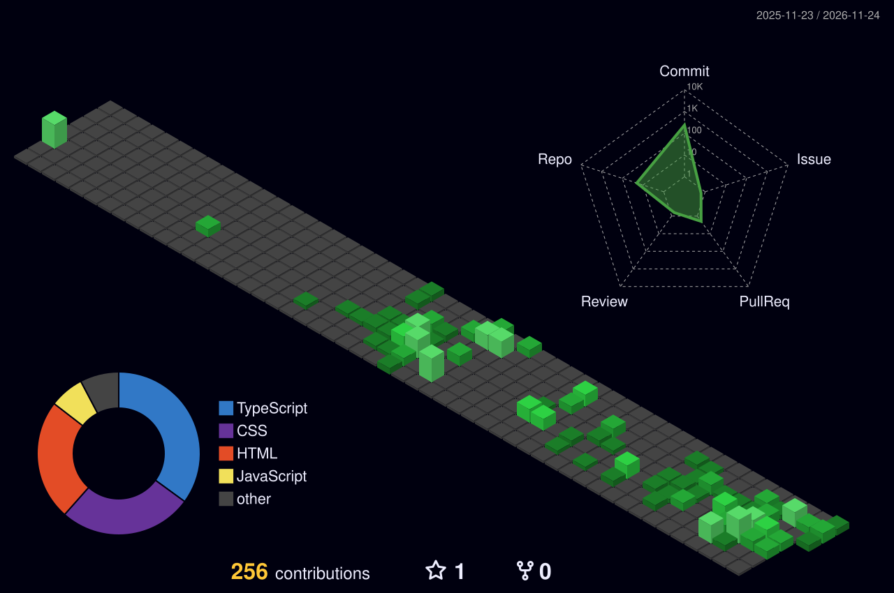

# Jadi Pereira Borges

### Desenvolvedora FullStack em desenvolvimento

Construindo experiências digitais com código, design e criatividade.

 

---

## Tecnologias e ferramentas

 

  

---

## Minhas contribuições

 

 

---

## Projetos em destaque

Projetos completos, do back-end ao celular: a mesma API atendendo a versão web e o app mobile.

 

### 🐾 PetVitaliz — clínica veterinária com planos de saúde para pets

Plataforma completa para tutores de pets: cadastro e perfil dos pets, contratação de planos de saúde, agendamento de consultas e serviços, benefícios e pagamentos. Do protótipo no **Figma** à publicação, com uma única API em Spring Boot atendendo o site e o aplicativo.

| | Back-end | Web | Mobile |
|---|---|---|---|
| **Stack** | Java 21 · Spring Boot 3.5 · Spring Security · JWT · MySQL · Docker | Angular · TypeScript · CSS | React Native · Expo · TypeScript |
| **Destaques** | Autenticação com JWT, e-mails, upload de imagens (Cloudinary), Swagger e testes com JUnit e Mockito. Migrada de Express + Prisma sem quebrar os clientes. | Área pública e área do cliente responsivas, contratação de planos, agendamento e painéis de admin e funcionário. | Perfil dos pets, planos, agendamentos, cartões e notificações, com a identidade visual da marca. |
| **Código** |  |  |  |

 

### 📚 Biblioteca Comunitária — gestão de livros e empréstimos

Sistema para administrar uma biblioteca comunitária: livros e estoque, autores, leitores com endereço e empréstimos com devolução, cancelamento e controle de atrasos. A API organiza as regras de negócio, e o painel web e o app mobile seguem o mesmo padrão visual.

| | Back-end | Web | Mobile |
|---|---|---|---|
| **Stack** | Java 21 · Spring Boot · Spring Data JPA · HATEOAS · Docker | Angular 17 (SSR) · TypeScript | React Native · Expo · TypeScript |
| **Destaques** | CRUD completo, paginação, consultas personalizadas, validação, tratamento global de erros e documentação com Swagger. | Painel administrativo para gerenciar livros, autores, leitores e empréstimos. | Painel no celular com totais, atrasos, estoque e novo empréstimo em 3 etapas. |
| **Código** |  |  |  |
| **No ar** |  |  | |

 

---

## Vamos nos conectar?

Estou aberta a novas conexões, projetos e oportunidades na área de tecnologia.

 

&nbsp;&nbsp;

  

### Código, criatividade e aprendizado contínuo.

